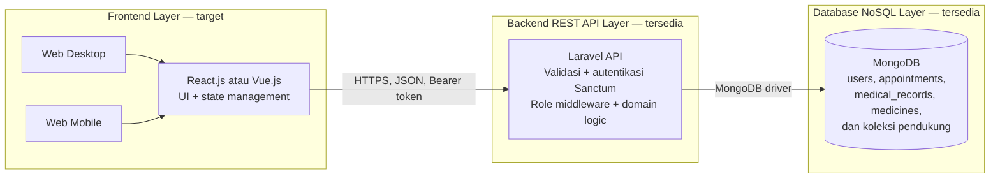

# Dokumen SRS dan SDS — SIMklinik

**Mata kuliah:** IF23P1405 — Pemrograman Web Lanjutan  
**Prodi/Kelas:** Teknik Informatika / PAGI2  
**Versi dokumen:** 1.0  
**Tanggal UTS:** 28 Oktober 2026  
**Status:** Rancangan UTS berdasarkan repository backend dan informasi tim tentang repository frontend terpisah

> **Catatan penting tentang kesesuaian tugas:** Repository yang diperiksa di sini adalah repository backend Laravel API, MongoDB, dan autentikasi token Laravel Sanctum. Menurut informasi tim, frontend React/Vue dikembangkan secara terpisah dan sudah memiliki progres; repository frontend tersebut belum diperiksa dalam dokumen ini. Token Sanctum yang dipakai backend bukan JWT. Dokumen ini mempertahankan mekanisme auth yang ada dan menjelaskan perbedaannya dengan persyaratan UTS.

## 1. Pendahuluan

### 1.1 Judul dan ringkasan proyek

**SIMklinik — Sistem Informasi Manajemen Klinik Terintegrasi**

SIMklinik mendukung pendaftaran dan pemantauan antrean pasien, jadwal praktik dokter, pencatatan rekam medis SOAP, inventaris obat berbasis batch FEFO, tagihan/pembayaran, serta pencatatan audit akses rekam medis. Sistem menyediakan REST API yang dapat dikonsumsi oleh aplikasi web terpisah.

### 1.2 Latar belakang dan identifikasi masalah

Operasional klinik melibatkan sejumlah peran dengan kebutuhan dan hak akses berbeda. Pencatatan jadwal, antrean, rekam medis, obat, serta pembayaran secara terpisah menyulitkan pemantauan alur pelayanan dan konsistensi informasi. SIMklinik menyediakan modul API terpusat untuk mendukung proses tersebut. Data klinik juga memiliki bentuk yang beragam: profil, jadwal, rekam medis SOAP, resep, dan batch obat.

Backend menggunakan MongoDB sebagai basis data dokumen. Dokumen JSON memudahkan penyimpanan atribut klinis terstruktur dan array seperti resep atau batch tanpa memaksakan bentuk tabel relasional untuk setiap subdata. Konsekuensinya, validasi bentuk dokumen, konsistensi referensi antar-koleksi, strategi indeks, dan pembatasan akses tetap harus dikelola oleh aplikasi.

Pemisahan frontend dan backend (decoupled) memungkinkan antarmuka React/Vue dikembangkan dan dirilis terpisah, sementara backend Laravel menyediakan kontrak REST API. Proyek ini menggunakan repository backend terpisah dari repository frontend; pekerjaan frontend telah berjalan menurut informasi tim, tetapi tautan repository frontend akan diisi oleh kelompok.

### 1.3 Tujuan

1. Menyediakan API untuk alur klinik yang melibatkan pasien, dokter, admin, dan apoteker.
2. Mengelola alur inti janji temu, antrean, jadwal, dan rekam medis.
3. Membatasi akses berdasarkan autentikasi dan peran pengguna.
4. Menyediakan spesifikasi yang dapat digunakan tim untuk membangun frontend dan menyelesaikan implementasi hingga UAS.
5. Menyatakan secara transparan perbedaan antara arsitektur/fitur saat ini dan persyaratan UTS.

### 1.4 Ruang lingkup dan batasan

**Ruang lingkup inti (MVP):** login/registrasi, profil pasien dasar, jadwal dokter, pembuatan dan konfirmasi janji temu, pemantauan antrean, rekam medis SOAP, billing dasar, pemotongan stok obat dengan batch FEFO, dan audit log akses rekam medis. Dashboard cukup berupa ringkasan sederhana; halaman billing, batch obat, dan audit log menampilkan field penting saja.

**Fitur tambahan, bukan target wajib:** rekomendasi dokter otomatis, dashboard analitik lanjutan, pencarian teks umum, dan alur antrean tambahan. Billing, batch FEFO, dan audit log tetap termasuk ruang lingkup; implementasinya cukup mengikuti alur dasar yang sudah ada tanpa menambah proses atau field yang tidak diperlukan.

**Di luar ruang lingkup:** penghitung berapa kali pasien dipanggil (`call_count`), pencatatan waktu panggilan terakhir (`last_called_at`), notifikasi otomatis, grafik analitik, pencarian teks umum, dan alur antrean tambahan yang tidak diperlukan untuk demonstrasi inti.

**Batasan teknis yang teramati:**

- Backend API: Laravel 13 dan PHP 8.5.
- Database: MongoDB menggunakan paket `mongodb/laravel-mongodb`.
- Autentikasi API: Laravel Sanctum personal access token melalui `Authorization: Bearer ...`; bukan JWT.
- Password: diproses dengan Laravel `Hash`; algoritma aktual mengikuti konfigurasi hashing aplikasi.
- Frontend React/Vue dikembangkan pada repository terpisah; tautan dan progres rinci perlu dicocokkan oleh tim.
- Kontrak API menggunakan JSON.
- Data API dan performa produksi tidak diukur dalam penyusunan dokumen ini.

## 2. Spesifikasi Kebutuhan Perangkat Lunak (SRS)

### 2.1 Aktor dan hak akses

| Aktor | Kebutuhan utama |
|---|---|
| Pasien | Mengelola profil sendiri, mencari jadwal/dokter, mendaftar antrean, melihat status dan riwayat medis miliknya. |
| Dokter | Mengelola jadwal praktik, melihat antrean, memperbarui alur antrean, dan mengisi rekam medis SOAP. |
| Apoteker | Mengelola data/batch obat dan menangani proses tagihan/pembayaran yang diizinkan. |
| Admin | Mengelola jadwal dan memantau data sistem sesuai hak akses. |

### 2.2 Kebutuhan fungsional

| ID | Kebutuhan | Kriteria penerimaan ringkas | Kondisi |
|---|---|---|---|
| FR-001 | Autentikasi dan otorisasi | Pengguna dapat mendaftar/login; kredensial salah ditolak; endpoint terlindungi memerlukan token dan role yang diizinkan. | Login dan middleware Sanctum/role tersedia. Skema token saat ini bukan JWT; lihat §5. |
| FR-002 | CRUD sumber daya klinik | Pengguna berwenang dapat melihat, menambah, mengubah, atau menghapus sumber daya sesuai haknya. | CRUD penuh tersedia untuk obat; modul lain menggunakan operasi khusus sesuai alur klinik. |
| FR-003 | Pencarian dan penyaringan data MongoDB | Pengguna dapat menyaring antrean menurut status, tanggal, dan dokter; hasil tidak melewati batas akses peran. | Filter tersebut tersedia pada daftar antrean. Pencarian teks umum tidak teramati. |
| FR-004 | Dashboard dan pemantauan | UI menampilkan ringkasan sederhana antrean/jadwal yang relevan bagi pengguna. | Dashboard perlu diverifikasi pada repository frontend terpisah; cukup gunakan kartu angka dan daftar ringkas, tanpa grafik analitik. |
| FR-005 | Pengelolaan profil pasien | Pasien dapat melihat/memperbarui profilnya dan mengetahui kelengkapan data yang dibutuhkan untuk membuat janji temu. | Endpoint profil dan indikator kelengkapan tersedia. |
| FR-006 | Pendaftaran janji temu dan antrean | Pasien membuat janji, memilih jadwal yang tersedia, mengonfirmasi, lalu melihat nomor dan status antrean. | Alur inti memakai endpoint appointments; rekomendasi dokter otomatis bukan kebutuhan wajib MVP. |
| FR-007 | Jadwal praktik dokter | Dokter/admin mengelola jadwal; pasien dapat melihat jadwal dan kuota yang tersedia. | Endpoint jadwal tersedia. |
| FR-008 | Rekam medis dan audit log | Dokter menyimpan SOAP; pengguna yang berwenang melihat riwayat; akses penting tercatat dalam audit log. | Endpoint rekam medis dan audit tersedia; tampilan audit dapat berupa tabel sederhana tanpa filter tambahan. |
| FR-009 | Obat, batch FEFO, dan billing | Pengguna berwenang mengelola stok obat per batch; billing menghubungkan tagihan dengan janji dan status pembayaran; stok dikurangi mengikuti FEFO sesuai alur yang ada. | Endpoint medicine dan billing tersedia. Cukup gunakan field inti, tanpa membuat laporan/otomasi baru. |

### 2.3 Kebutuhan non-fungsional

Target di bawah ini adalah kriteria penerimaan untuk diuji, bukan klaim hasil pengukuran saat ini.

| ID | Aspek | Target/kriteria |
|---|---|---|
| NFR-SEC-01 | Password | Password tidak disimpan sebagai teks biasa; verifikasi dilakukan dengan fasilitas hashing Laravel. Tetapkan dan dokumentasikan algoritma hashing yang berlaku di lingkungan deployment (misalnya bcrypt) sebelum menyatakan kepatuhan bcrypt. |
| NFR-SEC-02 | Token dan akses | Token dikirim melalui HTTPS di deployment; endpoint memeriksa autentikasi dan role; pasien hanya dapat melihat rekam medis miliknya. |
| NFR-PERF-01 | Performa | Target response time endpoint utama < 500 ms pada dataset uji sederhana; catat waktu respons dan kondisi uji. |
| NFR-PERF-02 | Indeks | Evaluasi indeks dasar untuk email dan pencarian jadwal/antrean; indeks tambahan hanya dibuat jika diperlukan. |
| NFR-UX-01 | Usability/responsiveness | Frontend tersedia untuk desktop dan mobile, navigasi konsisten per role, validasi form jelas, serta status loading/kosong/gagal terlihat. |
| NFR-MAINT-01 | Maintainability | Endpoint didokumentasikan, validasi konsisten, perubahan diuji, dan setiap fitur dikembangkan melalui feature branch lalu diintegrasikan ke `development` sebelum `main`. |
| NFR-DATA-01 | Integritas data | Validasi input dan referensi pasien, dokter, serta jadwal; pastikan janji, rekam medis, billing, stok, dan audit tersimpan sesuai alur. |

## 3. Desain dan Arsitektur Perangkat Lunak (SDS)

### 3.1 Diagram arsitektur target

Diagram berikut menjelaskan pemisahan frontend/backend sesuai arsitektur proyek. Repository frontend terpisah dan progresnya dilaporkan oleh tim; implementasinya tidak diperiksa dalam dokumen backend ini.



**Alur request:** pengguna login dan menerima token Sanctum; frontend menyimpan token secara aman dan mengirimkannya sebagai `Authorization: Bearer <token>` pada request yang memerlukan autentikasi. Backend memvalidasi token, role, dan input sebelum membaca atau mengubah dokumen MongoDB, lalu mengembalikan respons JSON.

### 3.2 Rancangan collection MongoDB

Skema berikut adalah contoh field inti untuk dokumen tugas, bukan instruksi migrasi atau penghapusan field yang sudah dipakai backend. Sesuaikan payload dengan implementasi yang ada; `_id` merupakan ObjectId MongoDB. Data identitas pada contoh sengaja tidak menggunakan data orang sungguhan.

#### `users`

```json
{
  "_id": "ObjectId",
  "name": "Nama Pengguna",
  "email": "user@example.test",
  "password": "hash-password",
  "phone": "08xxxxxxxxxx",
  "address": "Alamat pengguna",
  "role": "patient | doctor | pharmacist | admin",
  "created_at": "ISODate",
  "updated_at": "ISODate"
}
```

Password harus berupa hash dan tidak pernah dikembalikan oleh API. Profil pasien disimpan terpisah di `patients`, dengan `user_id` sebagai referensi ke pengguna.

#### `appointments` — collection utama

```json
{
  "_id": "ObjectId",
  "patient_id": "ObjectId/string referensi pasien",
  "doctor_id": "ObjectId/string, null saat draft",
  "doctor_schedule_id": "ObjectId/string, null saat draft",
  "date": "YYYY-MM-DD",
  "complaint": "Keluhan pasien",
  "guarantor": "umum | BPJS | asuransi",
  "queue_number": "A-001",
  "status": "draft | waiting | called | in_consultation | skipped | completed | cancelled",
  "created_at": "ISODate",
  "updated_at": "ISODate"
}
```

Contoh ini hanya memuat field dan status yang diperlukan untuk alur MVP; status tambahan yang mungkin didukung backend tidak wajib ditampilkan atau dikerjakan untuk demo inti.

Model pendukung yang telah ditemukan menggunakan koleksi `patients`, `doctors`, `doctor_schedules`, `medical_records`, `medical_record_audit_logs`, `medicines`, dan `billings`. Hubungan antar-koleksi menggunakan identifier; integritas referensi perlu dijaga di level aplikasi.

**Indeks minimum yang direkomendasikan untuk dievaluasi (belum diklaim telah diterapkan):** indeks unik `users.email` dan indeks pada field jadwal/antrean yang benar-benar dipakai untuk pencarian, misalnya `doctor_id + schedule_date` pada `doctor_schedules`. Tambahkan indeks lain hanya jika pengukuran menunjukkan kebutuhan.

#### `medicines` — obat dan batch FEFO

```json
{
  "_id": "ObjectId",
  "name": "Nama obat",
  "category": "Kategori",
  "base_price": 0,
  "batches": [
    {
      "batch_no": "Kode batch",
      "stock": 0,
      "exp_date": "YYYY-MM-DD"
    }
  ]
}
```

Setiap batch hanya memuat nomor batch, stok, dan tanggal kedaluwarsa yang diperlukan untuk memilih stok FEFO.

#### `billings` — tagihan dasar

```json
{
  "_id": "ObjectId",
  "appointment_id": "ObjectId/string",
  "patient_id": "ObjectId/string",
  "total_amount": 0,
  "guarantor": "umum | BPJS | asuransi",
  "payment_status": "unpaid | paid | cancelled | covered_by_bpjs",
  "payment_method": "cash | transfer | asuransi",
  "stock_deducted": false
}
```

Gunakan rincian biaya yang memang diperlukan oleh perhitungan billing yang sudah ada; hindari menambah rincian, status, atau data pembayaran baru yang tidak digunakan aplikasi.

#### `medical_record_audit_logs` — audit akses rekam medis

```json
{
  "_id": "ObjectId",
  "user_id": "ObjectId/string",
  "patient_id": "ObjectId/string",
  "action": "view_history | create | unauthorized_attempt",
  "medical_record_id": "ObjectId/string atau null",
  "accessed_at": "ISODate"
}
```

Field di atas adalah ringkasan untuk menjelaskan kebutuhan audit. Backend yang ada dapat tetap menyimpan metadata teknisnya; tidak perlu menambah field audit baru untuk memenuhi rancangan UI UTS.

### 3.3 Spesifikasi endpoint REST API

Base URL lokal: `http://127.0.0.1:8000/api`. Request/response menggunakan JSON. Endpoint selain registrasi/login memerlukan Bearer token Sanctum, selain akses tambahan berdasarkan role.

#### Autentikasi dan profil

| Method | Endpoint | Akses | Fungsi |
|---|---|---|---|
| POST | `/register` | Publik | Registrasi pasien atau apoteker; mengembalikan token Sanctum. |
| POST | `/doctors/register` | Publik dengan mekanisme proteksi pendaftaran dokter yang dikonfigurasi | Pendaftaran dokter. |
| POST | `/login` | Publik | Verifikasi email/password; mengembalikan token Sanctum dan informasi profil/role. |
| GET | `/patient/profile` | Pasien | Melihat profil sendiri dan kelengkapan profil. |
| PUT | `/patient/profile` | Pasien | Memperbarui profil sendiri. |

> Belum ditemukan route logout pada daftar route yang diperiksa. Perilaku penghapusan/revokasi token perlu dipastikan atau ditambahkan melalui perubahan terpisah sebelum mensyaratkan logout dari seluruh klien.

#### CRUD dan alur janji temu/antrean

| Method | Endpoint | Akses | Fungsi |
|---|---|---|---|
| GET | `/appointments` | Pasien, dokter, admin | Daftar antrean; pasien dibatasi ke miliknya, dokter/admin melihat data antrean non-draft; menerima filter `status`, `date`, `doctor_id`. |
| POST | `/appointments` | Pasien | Membuat draft janji temu. |
| PATCH | `/appointments/{id}/draft` | Pasien | Memperbarui draft. |
| GET | `/appointments/available-doctors` | Pasien | Melihat dokter/jadwal yang tersedia. |
| POST | `/appointments/{id}/confirm` | Pasien | Mengonfirmasi dokter/jadwal dan proses antrean. |
| PATCH | `/appointments/{id}/status` | Dokter, admin | Memperbarui status alur antrean. |
| GET | `/doctor-schedules/{doctorId}` | Pengguna terautentikasi | Melihat jadwal aktif dokter. |
| POST | `/doctor-schedules` | Dokter, admin | Menambah jadwal praktik. |
| PUT/PATCH | `/doctor-schedules/{doctor_schedule}` | Dokter, admin | Memperbarui jadwal praktik. |
| DELETE | `/doctor-schedules/{doctor_schedule}` | Dokter, admin | Menonaktifkan jadwal dengan mengatur `is_active=false`; data historis dipertahankan. |

#### Rekam medis, billing, inventaris, dan audit

| Method | Endpoint | Akses | Fungsi |
|---|---|---|---|
| POST | `/medical-records` | Dokter | Menyimpan rekam medis SOAP dan resep. |
| GET | `/medical-records/patient/{patientId}` | Pasien, dokter, admin | Melihat riwayat; pasien hanya boleh mengakses miliknya sendiri. |
| GET | `/medical-records/audit-logs` | Admin | Melihat daftar audit log rekam medis. |

| Method | Endpoint | Akses | Fungsi |
|---|---|---|---|
| GET | `/medicines` | Admin, apoteker, dokter | Melihat inventaris obat. |
| GET | `/medicines/{medicine}` | Admin, apoteker, dokter | Melihat detail obat. |
| POST | `/medicines` | Admin, apoteker | Menambah obat dan batch. |
| PUT/PATCH | `/medicines/{medicine}` | Admin, apoteker | Mengubah obat dan/atau batch. |
| DELETE | `/medicines/{medicine}` | Admin | Menghapus obat. |
| GET | `/billings` | Admin, apoteker, pasien | Melihat daftar tagihan. |
| GET | `/billings/{billing}` | Admin, apoteker, pasien | Melihat detail tagihan. |
| POST | `/billings` | Admin, apoteker | Membuat tagihan. |
| PUT/PATCH | `/billings/{billing}` | Admin, apoteker | Memperbarui status pembayaran. |

**Konvensi respons yang harus diikuti klien:** respons berhasil membawa status/pesan dan data; kesalahan autentikasi/otorisasi menggunakan status HTTP yang sesuai (umumnya 401/403), validasi 422, dan resource tidak ditemukan 404. Frontend perlu menampilkan pesan kesalahan API tanpa menganggap request gagal sebagai sukses.

### 3.4 Perancangan mockup dan UI — spesifikasi untuk dibuat di platform desain

Mockup interaktif dibuat di Figma/Adobe XD oleh tim; berikut spesifikasi layar dan alur sebagai pedoman, bukan tautan prototype yang sudah dibuat.

**Arah visual:** antarmuka klinik yang bersih dan mudah dipindai; gunakan satu warna utama untuk navigasi dan aksi, status antrean dengan label yang mudah dibaca, serta kontras teks yang memadai.

| Layar | Isi dan perilaku |
|---|---|
| Login | Logo/nama SIMklinik, email, password, tombol tampil/sembunyikan password, tombol masuk, tautan registrasi, validasi input, serta pesan kredensial salah. Setelah login, arahkan pengguna ke dashboard sesuai role. |
| Register pasien | Nama, email, password, telepon, alamat; data profil tambahan dapat dilengkapi pada halaman profil. Tampilkan validasi dan konfirmasi akun berhasil. |
| Dashboard sesuai role | Satu halaman ringkas dengan navigasi sesuai role; pasien melihat janji/status antrean, dokter melihat antrean hari ini, apoteker melihat ringkasan billing/stok, dan admin memiliki tautan audit log. Gunakan kartu sederhana, tanpa grafik analitik. |
| Booking janji temu | Form tanggal, keluhan, dan penjamin; daftar jadwal tersedia untuk dipilih; layar konfirmasi menampilkan ringkasan dan nomor antrean. Rekomendasi dokter otomatis tidak diperlukan. |
| Manajemen antrean | Tabel desktop atau kartu mobile berisi nomor antrean, pasien, dokter, tanggal, dan status; filter dasar tanggal/status. Tampilkan aksi status sesuai role. Tidak perlu penghitung pemanggilan atau histori waktu pemanggilan. |
| Form tambah/edit | Form sederhana untuk profil, jadwal, SOAP, dan obat. Form batch cukup berisi kode batch, stok, dan tanggal kedaluwarsa. |
| Riwayat medis dan audit | Riwayat SOAP dibatasi sesuai hak akses. Admin melihat tabel audit ringkas berisi waktu, pengguna, pasien, dan aksi; tidak perlu filter audit kompleks. |
| Billing | Tabel tagihan sederhana berisi pasien, nomor janji, jumlah, penjamin, dan status pembayaran; aksi ubah status sesuai role. |
| Inventaris obat | Tabel nama, kategori, harga, dan ringkasan stok; detail batch cukup menampilkan kode, stok, dan kedaluwarsa untuk FEFO. |

**Responsivitas:** desktop memakai sidebar dan tabel kolom lengkap; mobile memakai navigasi ringkas, kartu data bertumpuk, filter dalam drawer, tombol aksi yang mudah disentuh, dan form satu kolom. Kedua breakpoint harus menampilkan loading, empty state, error state, dan sukses.

**Alur klik prototype inti:**

1. Login → dashboard sesuai role.
2. Pasien: dashboard → buat janji → pilih tanggal/keluhan → pilih jadwal tersedia → konfirmasi → lihat nomor dan status antrean.
3. Dokter: dashboard → buka antrean → ubah status pasien → isi SOAP → simpan.
4. Apoteker: lihat batch obat → proses tagihan/pembayaran → stok terpotong berdasarkan batch terdekat kedaluwarsa.
5. Admin: buka daftar audit log ringkas.

## 4. Rencana Pengujian

### 4.1 Unit dan integration test (PHPUnit)

Gunakan PHPUnit sesuai test suite Laravel yang sudah ada. Data uji harus dibuat terisolasi dan tidak menggunakan data pasien nyata.

| Kelompok | Skenario utama | Hasil yang diharapkan |
|---|---|---|
| Auth | Registrasi valid, email duplikat, login valid, password salah, akses endpoint tanpa token | Status sukses sesuai kontrak; validasi ditolak; kredensial salah 401; request terlindungi tanpa token 401. |
| Otorisasi | Setiap role memanggil endpoint yang diizinkan dan dilarang | Role yang tidak sesuai menerima 403; pasien tidak dapat melihat rekam medis pasien lain. |
| Appointment | Buat janji, pilih jadwal tersedia, konfirmasi, lihat antrean dan filter dasar | Janji dan status tersimpan; jadwal penuh ditolak; filter dasar sesuai. |
| Medical record dan audit | SOAP valid/tidak valid, akses riwayat, dan pencatatan aksi utama | Input tidak valid ditolak; pasien tidak dapat melihat riwayat pasien lain; aksi penting tercatat. |
| Billing dan FEFO | Pembayaran dasar, pemotongan stok dari batch terdekat kedaluwarsa, dan stok tidak cukup | Status tagihan benar; stok dikurangi sesuai FEFO atau proses ditolak bila stok tidak cukup. |
| Medicine | CRUD dasar obat dan batch | Akses role benar; stok dan tanggal kedaluwarsa batch tersimpan. |
| Performa | Ukur satu endpoint daftar utama pada dataset uji sederhana | Catat ukuran dataset, lingkungan, waktu respons, dan bandingkan dengan target <500 ms. |

### 4.2 Evaluasi autentikasi dan keamanan

- Pastikan password disimpan sebagai hash dan tidak ikut dalam payload respons.
- Uji token tidak ada/tidak valid dan akses berdasarkan role.
- Pastikan token hanya dikirim melalui HTTPS di lingkungan deployment dan tidak dicatat ke log.
- Uji bahwa data rekam medis hanya dapat dilihat pasien yang bersangkutan serta role klinis/admin yang berwenang.
- Periksa pembatasan akses pendaftaran role sensitif dan endpoint yang melibatkan data kesehatan.
- Untuk memenuhi persyaratan soal mengenai JWT secara penuh, lakukan keputusan dan perubahan terpisah setelah perbandingan teknis di §5; jangan mengidentifikasi token Sanctum sebagai JWT dalam hasil uji.

### 4.3 Pengujian performa

Gunakan dataset sintetis kecil untuk endpoint daftar antrean atau jadwal. Catat lingkungan pengujian dan waktu respons; target soal adalah <500 ms. Pengujian beban lanjutan bersifat opsional; hasil pengukuran belum tersedia saat dokumen ini dibuat.

## 5. Penjelasan perbedaan Sanctum dan JWT

| Aspek | Implementasi saat ini: Laravel Sanctum | JWT (JSON Web Token) |
|---|---|---|
| Bentuk kredensial | Personal access token opaque: klien menerima string token; server memverifikasi token melalui mekanisme/token store Sanctum. | Token terstruktur berisi header, payload, dan signature; klaim dapat dibaca, tetapi signature harus diverifikasi. |
| Stateless | Umumnya memerlukan penyimpanan token agar token dapat dikenali dan dicabut. | Validasi signature dapat dilakukan tanpa lookup sesi pada setiap request; pencabutan dini memerlukan strategi tambahan seperti denylist/rotasi token. |
| Payload | Tidak membawa klaim terstruktur yang dapat dibaca klien sebagai JWT. | Dapat membawa klaim seperti subject, issuer, audience, expiry, dan role; jangan menaruh data rahasia karena payload bukan terenkripsi secara default. |
| Pencabutan | Token personal dapat dikelola/dicabut melalui penyimpanan token Sanctum. | Token yang sudah diterbitkan umumnya berlaku sampai expiry kecuali sistem menerapkan denylist, rotasi, atau mekanisme revokasi lain. |
| Kesesuaian proyek | Sudah terpasang dan digunakan oleh `HasApiTokens`, endpoint login/register, serta middleware `auth:sanctum`. | Disebut sebagai opsi wajib/target pada instruksi UTS, tetapi belum digunakan oleh backend saat ini. |
| Dampak perubahan | Tidak membutuhkan migrasi auth untuk kondisi sekarang. | Memerlukan keputusan library dan desain token, perubahan penerbitan/verifikasi/revokasi, konfigurasi secret/key dan expiry, penyesuaian middleware/klien, serta pengujian ulang. |

**Kesimpulan untuk laporan:** sistem saat ini menggunakan **Bearer token Laravel Sanctum**, bukan JWT. Keduanya dapat digunakan untuk autentikasi API, tetapi format token, cara verifikasi, pengelolaan state, dan strategi pencabutan berbeda. Karena mekanisme saat ini dipertahankan, requirement JWT pada soal harus dinyatakan sebagai gap terhadap implementasi. Bila dosen menuntut bukti JWT, migrasi/penambahan JWT harus disepakati dan dikerjakan sebagai perubahan arsitektur terencana, bukan sekadar mengganti label dokumentasi.

## 6. Timeline pengerjaan W1–W16

Pembagian berikut mengikuti fase dalam template soal. Tanggal kalender untuk W1–W16 tidak ditetapkan karena tanggal mulai semester tidak tercantum. Ganti placeholder anggota setelah kelompok terbentuk.

| Minggu | Fase | Kegiatan utama | Penanggung jawab | Deliverable |
|---|---|---|---|---|
| W1–W2 | Analisis & perancangan | Identifikasi masalah klinik, aktor, ruang lingkup, kebutuhan, risiko, dan penyusunan draft SRS. | Project Lead + seluruh anggota | Draft SRS dan backlog awal. |
| W3–W4 | Desain UI/UX & API spec | Alur pengguna, wireframe/mockup Figma, rancangan responsive, review kontrak endpoint dan skema data. | Frontend Engineer + Backend Engineer | Prototype awal dan API specification. |
| W5–W7 | Persiapan lingkungan & UTS | Review SRS/SDS, repository dan branching, rancangan MongoDB, rencana testing, presentasi UTS. | Seluruh anggota | Dokumen SRS/SDS, mockup, repo dan board awal, presentasi UTS. |
| W8–W10 | Pengembangan backend | Autentikasi sesuai keputusan tim, CRUD/alur API, validasi, indeks MongoDB yang diuji, unit/integration test. | Backend Engineer | REST API dan hasil pengujian backend. |
| W11–W13 | Pengembangan frontend | Komponen UI, state management, login/role, integrasi API, loading/error state, responsivitas. | Frontend Engineer | Frontend terintegrasi pada environment uji. |
| W14–W15 | Pengujian & debugging | Uji booking, SOAP, billing/FEFO, akses audit dasar, cek target waktu respons, dan perbaikan bug utama. | Project Lead + Backend Engineer + Frontend Engineer | Ringkasan hasil uji dan kandidat rilis. |
| W16 | Evaluasi / UAS | Demonstrasi sistem terintegrasi, serah-terima dokumen, evaluasi akhir dan presentasi. | Seluruh anggota | Aplikasi web decoupled dan paket UAS. |

### Pembagian kerja tim (isi nama anggota)

| Peran | Nama | Tanggung jawab |
|---|---|---|
| Project Lead & Integration Engineer | `[Nama anggota 1]` | SRS/SDS, integrasi, board/timeline, dokumentasi API, koordinasi rilis dan presentasi. |
| Backend & API Engineer | `[Nama anggota 2]` | Laravel API, MongoDB, autentikasi, otorisasi, dan pengujian alur inti termasuk billing/FEFO. |
| Frontend Engineer | `[Nama anggota 3]` | React/Vue, mockup/prototype, integrasi API, dan UI sederhana untuk booking, SOAP, billing, stok, serta audit. |

## 7. Kolaborasi dan luaran UTS

| Luaran | Status / lokasi |
|---|---|
| Repository backend | [Diwa-code/SIMklinik-Backend](https://github.com/Diwa-code/SIMklinik-Backend). Repository backend yang diperiksa; keberadaan branch `development` dan feature branch perlu dibuat/dikonfirmasi oleh tim. |
| Repository frontend | Menurut informasi tim, frontend dikerjakan terpisah dan sudah memiliki progres. Tautan sementara: `https://github.com/[USERNAME-ATAU-ORGANISASI]/[NAMA-REPOSITORY-FRONTEND]` — ganti placeholder ini dengan URL repository frontend yang benar sebelum pengumpulan. |
| Feature branching / Git Flow | Usulan: `main` untuk rilis stabil, `development` untuk integrasi, dan `feature/<nama-fitur>` untuk pekerjaan masing-masing. Pull request feature → development; setelah review dan pengujian, release → main. Jangan mengerjakan fitur langsung di `main`. |
| Project board | Buat board Trello/GitLab dengan kolom **To Do**, **Doing**, **Done**; kartu per deliverable, assignee sesuai pembagian peran, due week, checklist acceptance, dan tautkan PR. **Tautan board belum tersedia** dan harus diisi setelah board dibuat. |
| API documentation/workspace | Dokumentasi pengujian endpoint tersedia di [ENDPOINT_API.md](./ENDPOINT_API.md); ringkasan API ada di [README.md](./README.md). Tautan Postman Workspace/Swagger belum tersedia dan harus diisi setelah workspace dibuat/dipublikasikan. |
| Prototype UI | Buat frame desktop dan mobile, sambungkan alur klik §3.4, dan bagikan tautan Figma/Adobe XD. Tautan prototype belum tersedia karena mockup dibuat oleh tim di platform terpisah. |
| Dokumen desain pendukung | Diagram dan artefak sistem yang ada berada di folder `docs/`; dokumen SRS/SDS ini adalah [UTS_SRS_SDS_SIMKLINIK.md](./UTS_SRS_SDS_SIMKLINIK.md). |

**Checklist sebelum pengumpulan:** ganti nama anggota dan placeholder URL repository frontend; isi tautan prototype, board, dan Postman/Swagger; konfirmasi branch dan pembagian tugas aktual; uji alur inti serta catat waktu respons; samakan istilah auth dengan implementasi atau keputusan migrasi yang benar-benar dilakukan.

## 8. Rencana demonstrasi/presentasi UTS (10–15 menit)

1. **Pembukaan dan masalah (1–2 menit):** tujuan SIMklinik dan aktor utama.
2. **Arsitektur dan kebutuhan (3 menit):** tunjukkan repository frontend terpisah beserta progresnya, Laravel REST API, MongoDB, dan jelaskan bahwa autentikasi backend saat ini Sanctum, bukan JWT.
3. **Mockup/prototype (4–5 menit):** login, booking, antrean dokter, SOAP, billing/FEFO sederhana, dan tabel audit.
4. **API dan data (2–3 menit):** endpoint inti, collection MongoDB dengan field seperlunya, autentikasi, dan hak akses.
5. **Kolaborasi dan penutup (1–2 menit):** repository/branch, board dan pembagian kerja, timeline hingga W16, risiko/gap dan langkah tindak lanjut.
